<h1 align="center">Method-Figure</h1>

<p align="center">
  <b>English</b>
  &nbsp;|&nbsp;
  <a href="README.zh-CN.md"><b>简体中文</b></a>
</p>

<p align="center">
  <b>Publication-grade pipeline, framework and teaser figures for AI conference papers.</b><br>
  Write a short spec — or point it at your model code — and get a figure that is
  <b>natively editable in Visio and PowerPoint</b>, plus PDF for LaTeX and 600 dpi PNG.
</p>

<p align="center">
  <a href="#quickstart">Quickstart</a> ·
  <a href="#install">Install</a> ·
  <a href="#from-code">From code</a> ·
  <a href="#the-template-gallery">Templates</a> ·
  <a href="#editing-the-output-visio-powerpoint-illustrator">Visio</a> ·
  <a href="#the-auditor">Auditor</a> ·
  <a href="#faq">FAQ</a>
</p>

<p align="center">
  <a href="https://github.com/ChizkiyahuOhayon/Method-Figure/actions/workflows/test.yml"></a>
  
  
  
  
</p>

<p align="center">
  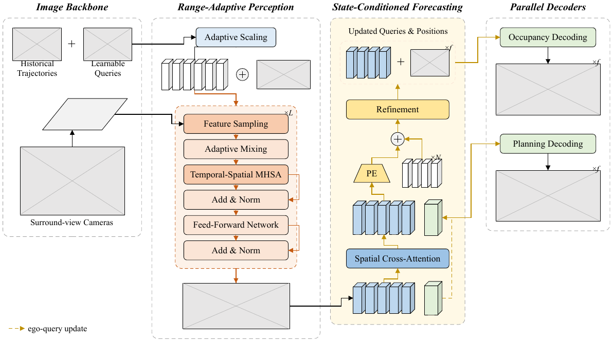
</p>

---

## What's new in v3

**3.1** fixes what auditing all 17 figures of that submission with 3.0 turned
up. First, a shadow inherited from the theme: LibreOffice draws it even under
an empty `<a:effectLst/>`, while PowerPoint and Keynote hide it. FigGenie's
PPTX had 139. It is now an error. Second, class legends for occupancy renders
were reported as orphaned. The auditors now look for the colours inside the
pictures, counting shaded tones. Third, enlarged subscripts dropped too far
in LibreOffice. The engine now writes a shift that keeps them at 0.20 × body,
and `script-too-low` catches hand-enlarged ones. `audit_pptx.py --fix` writes
a repaired copy for the first and third.

v3 comes from using v2.0 on a real CVPR submission, where everything that
went wrong went wrong *after* the figure left the engine — in the hand-edited
PPTX and the PDF exported from it.

- **The audit follows the file.** `audit_pptx.py` audits any PPTX after it
  has been edited by hand (in WPS, PowerPoint or Keynote, and FigGenie's
  PPTX too): bent arrows WPS will draw at 45°, flattened subscripts,
  legend entries for deleted arrows, unglued arrows, type that prints too
  small, low-ppi pictures, raster effects. `audit_pdf.py` audits the PDF LaTeX
  includes; `export_pptx.py` exports it losslessly — LibreOffice's default
  turned a 4000 ppi crop into a 298 ppi JPEG.
- **Every symbol is defined.** Labels take LaTeX maths (`$z_{1:4}$`,
  `$\tilde c_s$`, `$N \times C$`), set italic and spaced like the paper.
  A `symbols:` table and the caption (inline, or read straight out of your
  `.tex`) are checked: a symbol defined neither in a label nor in the caption
  is an error. One `paper.yaml` shares colours and notation across figures.
- **Bigger type.** Labels 7.5 pt, titles 8.5 pt — the median of the papers
  users want their figures to look like (SparseWorld, Occ3D, BEVDepth). Floor
  6.0 pt; module names ≥ 7.0 pt. `type_scale` enlarges a whole figure.
- **No generated look.** Tailwind / Material / Bootstrap colours are an error,
  saturated fills and colour-matched outlines are flagged; the contribution is
  warm orange, outputs green, inherited parts grey.
- **Arrows that survive editing.** PPTX arrows are glued Office connectors —
  move a module and its arrows follow. A bent arrow's last run is always long
  enough for WPS to aim its head; parallel wires get their own lanes; the
  router widens a gap rather than squeezing wires together. Arrowhead sizes
  match between SVG and PPTX for the application that exports your PDF.
- **Measured in four applications.** What WPS, Keynote, LibreOffice and
  PowerPoint each do with the same file is tabulated in
  [`references/app-compatibility.md`](references/app-compatibility.md).

Full list in [`CHANGELOG.md`](CHANGELOG.md).

---

## Why this exists

Machine-made framework figures are not ugly. They are **generic**, and reviewers
recognise them in about a second:

| The tell | What a real conference figure does instead |
|---|---|
| Saturated rainbow fills, one hue per box | 3–5 pale tints, each meaning exactly one thing |
| Drop shadows, gradients, glassmorphism | Flat fills, one black hairline outline |
| Gears, brains, clouds, sparkles, emoji | Tensors as slabs, encoders as trapezoids |
| Whole sentences inside boxes | Noun phrases, six words or fewer |
| Identical boxes on a perfect grid | Widths that encode importance |
| Floating curved arrows that miss their ports | Orthogonal runs on port normals |
| No real data anywhere | Real input crops and real output renders, embedded |
| "Figure 1: Overview of the proposed framework." | A caption that states a claim |

Every one of those is a *default*. `Method-Figure` removes them from the engine so
they cannot come back by accident:

- the palette, type sizes, stroke weights, corner radii and padding were
  **measured out of the vector content of 349 published figure PDFs**, not
  invented — the full audit trail, including three rules that were tested and
  cut for lack of evidence, is in
  [`references/corpus-report.md`](references/corpus-report.md);
- layout is solved deterministically **in final printed points** — `size: 7.5`
  in the spec is 7.5 pt on the printed page, with no mental arithmetic;
- arrows are *forced* to leave and enter along port normals and turn at right
  angles;
- an **auditor** must pass before you ship, and it names each tell individually.

### The findings that set the style

v2 re-derived every constant from a wider corpus: **46 papers** with complete
arXiv sources from three groups whose figures this project is trying to sound
like — Tsinghua MARS, Wenzhao Zheng's group, and Megvii — covering **292 figure
environments** and **349 figure PDFs**, read with PyMuPDF.

**Almost nobody draws in TikZ.** One of 290 figures uses `tikzpicture`, and it
is an ablation bar chart, not a diagram. Every architecture figure in the
corpus is external artwork placed with `\includegraphics`, and 86% are a
*single* file — the
composition happens in the drawing tool, not in LaTeX. The embedded font tables
say which tool: Calibri and Cambria Math (PowerPoint/Visio), Segoe Print
(Windows), Times New Roman PS MT set by hand. So generating a native
`.pptx`/`.vsdx` with an Office palette is not a stylistic preference — it is a
reconstruction of the actual production pipeline.

**The palette is three colour pickers, not one.** 101 colours appear in four or
more distinct figures, and they resolve cleanly into the Office 2013+ theme
ladder, the diagrams.net stock styles (which ship as fill/stroke *pairs*), and
matplotlib's `tab10` confined to plot panels. `palettes.py` keeps all three
whole rather than blending them:

```
#DEEBF7 #BDD7EE #9DC3E6 #5B9BD5 #2E75B6   Office Blue Accent 5, verbatim
#E2F0D9 #C5E0B4 #A9D18E #70AD47 #548235   Green Accent 6
#FFF2CC #FFE699 #FFD966 #FFC000 #BF9000   Gold Accent 4
#DAE8FC / #6C8EBF   #D5E8D4 / #82B366     draw.io pairs -- never split
strokes: 45% of all stroke length is pure #000000
```

**Type is smaller than anyone admits.** Applying each figure's own
canvas-to-column scale factor (median 0.385), the rendered glyph distribution
has a median of **6.0 pt** and quartiles at 4.5 and 7.5. The median *smallest*
glyph in a figure is 5.4 pt. v2.0 set its floor there — and figures built at
that size read as small. v3 re-measured the papers users hold up as the
target (SparseWorld's Visio overview prints at a 7.5 pt median, Occ3D's at 8.2,
BEVDepth's at 8.6) and moved to 7.5 pt labels with a 6.0 pt floor. The same
scan showed v1's stroke weights were about **2× too heavy**: the real rendered
modes are 0.19, 0.36, 0.45 and 0.80 pt.

**Framework figures contain real data.** 57% of the architecture diagrams embed
at least one raster — median **11** of them, about a quarter of the canvas — and
**66% of those put images at both the far left and the far right**. Inputs in,
predictions out, architecture between. That is why `image`, `imagegrid` and
`cameraring` exist, why `image` takes its aspect ratio from the real file, and
why the auditor nudges a pipeline drawn as boxes alone.

---

## Quickstart

No install, no dependencies. Clone and render:

```bash
git clone https://github.com/ChizkiyahuOhayon/Method-Figure.git
cd Method-Figure

python3 scripts/render.py examples/quickstart.yaml -o build/quickstart \
        -f svg,pdf,png,pptx,vsdx --dpi 600
```

```
wrote build/quickstart.svg
wrote build/quickstart.pdf
wrote build/quickstart.png
wrote build/quickstart.pptx
wrote build/quickstart.vsdx
  pdf via libreoffice (lossless)
  png via pdftoppm @600 dpi -- 4146 x 1544 px
  pptx: 44 shapes, 0 embedded image(s), 8 glued connector(s)
  pdf audit: 0 error(s), 0 warning(s)
  canvas 496.8 x 184.9 pt | 10 nodes | 8 edges | scale 1.000
```

<p align="center">
  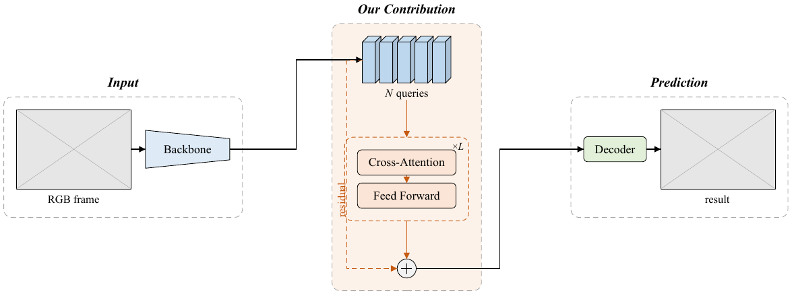
</p>

That came from [`examples/quickstart.yaml`](examples/quickstart.yaml), which is
about 50 lines. Open `build/quickstart.pptx` in PowerPoint or
`build/quickstart.vsdx` in Visio and drag a box: **everything is a native
shape**, no ungrouping required, and the arrows are glued: drag a box in
PowerPoint or WPS and its arrows follow.

Then check it:

```bash
python3 scripts/validate.py examples/quickstart.yaml --svg build/quickstart.svg
# WARN empty-image-slot  2 image slot(s) have no `src` ...
# 0 error(s), 1 warning(s), 0 note(s) | 497 x 185 pt | 10 nodes
```

The one warning is honest: the two image slots are placeholders until you
give them real crops.

After you edit the PPTX by hand, audit what ships instead of the spec:

```bash
python3 scripts/audit_pptx.py build/quickstart.pptx --width 496.8 --spec examples/quickstart.yaml
python3 scripts/export_pptx.py build/quickstart.pptx --width 496.8   # lossless PDF, then audit_pdf
```

---

## Install

### As a Claude Code skill (recommended)

```bash
git clone https://github.com/ChizkiyahuOhayon/Method-Figure.git
cd Method-Figure
./install.sh              # -> ~/.claude/skills/method-figure   (all projects)
./install.sh --project    # -> ./.claude/skills/method-figure   (this repo only)
```

The installer copies the skill, runs a self-test, and reports which optional
converters it found.

> The project is **Method-Figure**, but the installed skill id is `method-figure`
> in lowercase — Claude Code skill ids are lowercase-kebab, so that is what you
> type after the slash.

Then just ask, in plain language:

> Read `method.tex` and draw the overview figure for a CVPR submission,
> full width. Export a PDF for LaTeX and an editable `.vsdx`.

Claude Code loads [`SKILL.md`](SKILL.md), fills in the figure contract, picks an
archetype, writes the spec, renders, audits and hands back the LaTeX block.
You can also invoke it explicitly with `/method-figure`.

### With Codex, Cursor, Aider, or a plain API loop

Point the agent at [`AGENTS.md`](AGENTS.md) — the same instructions without the
Claude Code routing metadata:

```bash
git clone https://github.com/ChizkiyahuOhayon/Method-Figure.git third_party/Method-Figure
# then, in your AGENTS.md / .cursorrules / system prompt:
#   "For any framework, pipeline, teaser or module figure,
#    follow third_party/Method-Figure/AGENTS.md."
```

`agents/openai.yaml` carries the display name and default prompt for hosts that
read it.

### By hand, without an agent

The engine is a normal CLI. Copy the template closest to your figure, edit the
YAML, render. Everything in [`references/spec-language.md`](references/spec-language.md).

### Requirements

| | |
|---|---|
| **Required** | Python 3.8+. That is all — the engine is standard library only. |
| **Optional** | PyYAML (a bundled parser covers the same subset, byte-identically, when it is absent) |
| **For `.pdf`** | any one of Inkscape, LibreOffice, `rsvg-convert`, CairoSVG |
| **For `.png` / `.tiff`** | `pdftoppm` (poppler-utils) or ImageMagick |
| **For `.emf`** | Inkscape or LibreOffice |
| **For the hand-over audits** | PyMuPDF (`audit_pdf.py`); Pillow or PyMuPDF to look for legend colours inside pictures |

`.svg`, `.vsdx` and `.pptx` are written by bundled code and **always** work.

<details>
<summary>Installing the optional converters</summary>

```bash
# macOS
brew install --cask inkscape libreoffice
brew install poppler imagemagick

# Debian / Ubuntu
sudo apt install inkscape libreoffice-draw poppler-utils imagemagick librsvg2-bin

# minimal: poppler + librsvg is enough for PDF and high-resolution PNG
```
</details>

---

## How it works

Three steps. The skill walks an agent through all three; by hand you do the same.

### 1. The figure contract — before drawing anything

[`static/core/contract.md`](static/core/contract.md) asks seven questions. The
first one does most of the work:

> This figure makes the reader believe: ______________________

If the sentence needs an "and", it is two figures. If it is *"this is the
architecture of our method"*, that is a description, not a claim, and it
produces a figure with nothing to emphasise.

You also fix the archetype, the one element that is the contribution, the
semantic colour map, the venue and column width, and which real crops will fill
the image slots.

### 2. The spec — semantics, not pixels

You state **what goes where in what order**. The engine decides geometry.

```yaml
figure: {id: overview, venue: cvpr, width: double, font: times}

layout: row
gap: 14

panels:
  - id: s_core
    title: "Our Contribution"          # bold italic, above a dashed container
    frame: dashed
    fill: orange.pale
    body:
      - {id: q, shape: slab, n: 5, cell: 8, cellh: 26, role: attention,
         caption: "$N$ queries"}                # maths: italic, like the paper
      - group:                          # a tinted sub-region with a repeat badge
          id: blk
          frame: region
          frame_color: orange.deep
          badge: "$\\times L$"
          body:
            - {id: b1, text: "Cross-Attention", role: core}
            - {id: b2, text: "Feed Forward",    role: core, tint: light}

edges:
  - {from: q, to: blk, color: orange.deep}
  - {from: q.w, to: sum.w, route: bus, bend: 10, dash: true, label: "residual"}

symbols:                                # every symbol the figure shows
  "N":       {meaning: "number of queries", defined_in: figure}
  "L":       {meaning: "number of decoder layers", defined_in: caption}
  "\\oplus": {meaning: "element-wise addition", defined_in: caption}

caption: >-                             # or caption_tex: sec/3_method.tex#fig:overview
  \textbf{Learnable queries read the image once per layer.} $N$ queries
  cross-attend in each of $L$ layers and are added back ($\oplus$).
```

Two properties do most of the "this looks hand-made" work:

- **uniform snapping** — box-shaped siblings in a column are snapped to the
  widest, and in a row to the tallest, so a stack of modules sits on a grid;
- **port-normal routing** — whatever route you ask for, the line leaves along
  the source port's normal and arrives along the target's, and turns at right
  angles. No arrowhead ever lands flat against an edge, and the run after the
  last bend is always long enough for every editor to aim the head.

### 3. The audit — before you ship

```bash
python3 scripts/validate.py spec.yaml --svg build/fig.svg
```

Fix every `FAIL`. Justify or fix every `WARN`. Then do the eye pass in
[`references/anti-ai-checklist.md`](references/anti-ai-checklist.md): squint
test, trace one path with a finger, cover the caption, convert to greyscale.

---

## From code

<a name="from-code"></a>

Point it at a model implementation and get a first-draft spec. **Nothing is
imported or executed** — both readers parse with `ast`, so there is no
dependency install, no checkpoint download and no CUDA.

```bash
# what model classes are in this package?
python3 scripts/from_code.py bevdepth/layers/ --list

# draw one
python3 scripts/from_code.py bevdepth/layers/ --model DepthNet -o fig.yaml
python3 scripts/render.py fig.yaml -o build/depthnet -f svg,pdf,pptx
```

<p align="center">
  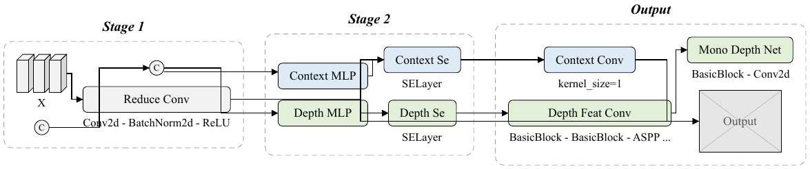
</p>

That is `DepthNet` straight out of BEVDepth with no hand editing. The reader
recovered the two parallel branches from `forward`, pulled the `nn.Sequential`
contents into the captions, pruned the norm/dropout plumbing, and coloured the
branches apart because the module names gave role inference nothing to work
with.

If the model ships an **mmengine / mmdet / mmdet3d config**, use that instead —
it names every stage in pipeline order with its channel widths, and it is a far
better source than the class hierarchy:

```bash
python3 scripts/from_code.py configs/model.py --mm -o fig.yaml
```

### It fits the column for you

A draft wider than its column gets silently downscaled at render time, and
downscaling is exactly how figures end up with 5 pt labels. So the emitter
measures its own draft and reshapes it, reporting each concession:

```
$ python3 scripts/from_code.py configs/sparseworld.py --mm -o fig.yaml
  7 nodes, 6 edges, 7 layers from BEVStereo4DOCC
  fit: dropped channel captions; abbreviated module names;
       dropped 1 peripheral modules to fit the column
```

In order: drop the channel captions, abbreviate names the way the corpus writes
them (`img_bev_encoder_backbone` → `BEV Enc. Backbone`), shed the least
connected boxes, and only as a last resort fold into two bands with a proper
return sweep.

### It is a draft, not an answer

The reader gets the modules, their order and the branch structure right. It has
no idea which module is your contribution. Before you ship, expect to:

- rename boxes to the names the *paper* uses, not the attribute names;
- delete anything the paper does not discuss — the corpus median framework
  figure has **11** boxes;
- attach real `src:` crops to the input and output slots;
- check cross-branch arrows against what `forward` actually does;
- give the contribution `role: core` and its own panel.

Known limits are written down rather than glossed:
[`references/from-code.md`](references/from-code.md) lists what the reader
flattens (both arms of an `if`), what it cannot see (functional calls,
`_base_` config inheritance) and what it guesses (`for blk in self.blocks`
becomes `×N`, because the count is not in the source).

---

## The template gallery

Copy the one closest to your figure and replace the content. Starting from a
blank spec wastes effort and loses the proportions that make an archetype work.

A paper usually needs **one teaser-class figure plus one or two others**.
Needing a third framework figure is almost always a sign that the method has
not been factored cleanly.

### Architecture papers — the contribution is a model

<table>
<tr>
<td width="50%"><a href="templates/pipeline-4stage.yaml"></a></td>
<td width="50%"><a href="templates/teaser-comparison.yaml">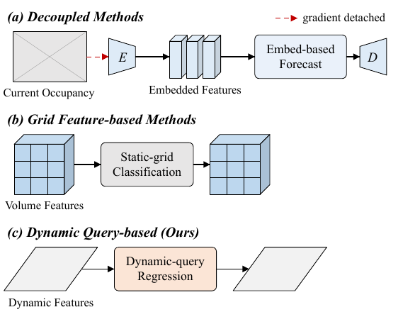</a></td>
</tr>
<tr>
<td><b><code>pipeline-4stage</code></b><br><i>"What are the moving parts?"</i><br>3–5 dashed stage containers, tinted wash on the contribution, per-stage arrow colour. Double column.</td>
<td><b><code>teaser-comparison</code></b><br><i>"Isn't this just X?"</i><br>Paradigm rows (a)(b)(c…Ours) sharing one colour vocabulary, so only the operator changes. Page 1, single column.</td>
</tr>
<tr>
<td><a href="templates/module-detail.yaml">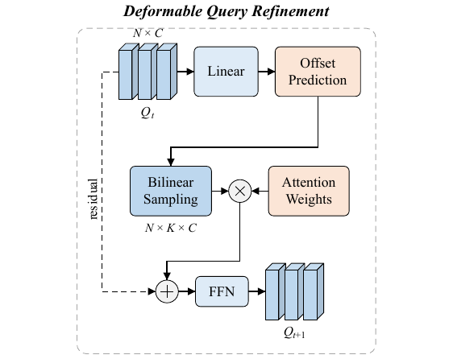</a></td>
<td><a href="templates/attention-tokens.yaml">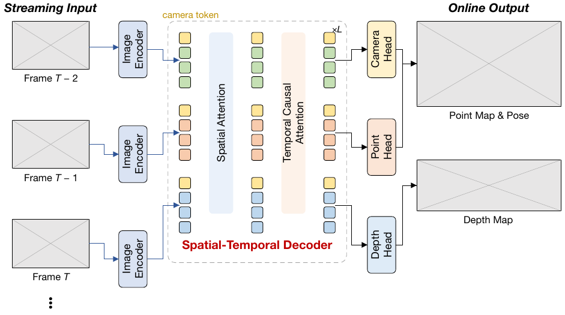</a></td>
</tr>
<tr>
<td><b><code>module-detail</code></b><br><i>"Does the maths match the wiring?"</i><br>One block expanded, operators explicit, tensor shapes annotated. Single column.</td>
<td><b><code>attention-tokens</code></b><br><i>"Why is this attention pattern better?"</i><br>Token banks coloured by provenance passing through pale attention regions. Double column.</td>
</tr>
<tr>
<td><a href="templates/streaming-worldmodel.yaml">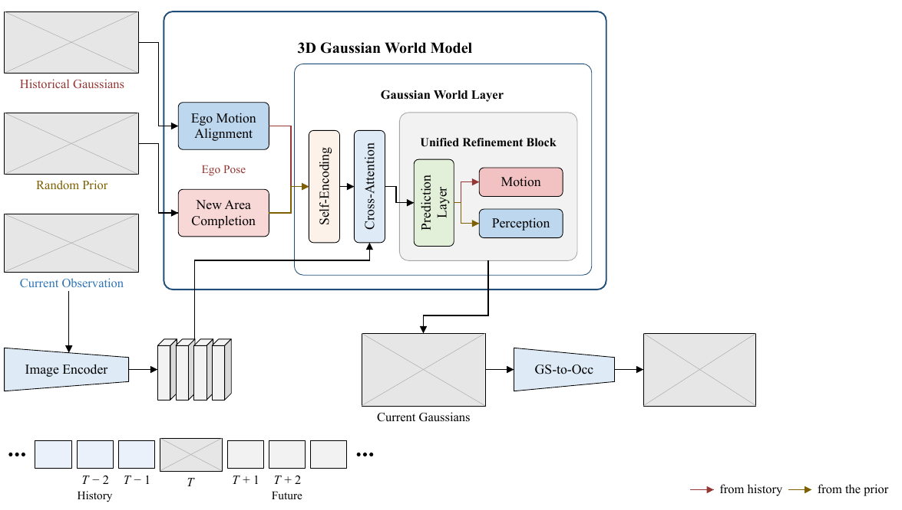</a></td>
<td><a href="templates/dual-branch.yaml">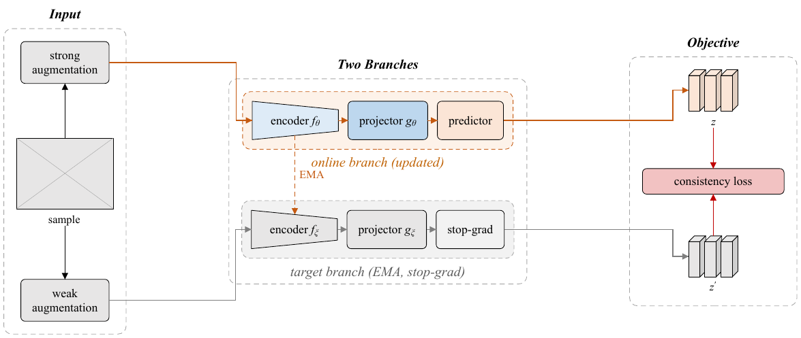</a></td>
</tr>
<tr>
<td><b><code>streaming-worldmodel</code></b><br><i>"What is remembered between steps?"</i><br>Nested containers plus a time rail; labels coloured to match their stream. Double column.</td>
<td><b><code>dual-branch</code></b><br><i>"How do the two branches relate?"</i><br>Teacher–student, contrastive, EMA. Parallel branches, dashed stop-grad link. Double column.</td>
</tr>
<tr>
<td colspan="2"><a href="templates/gated-module.yaml">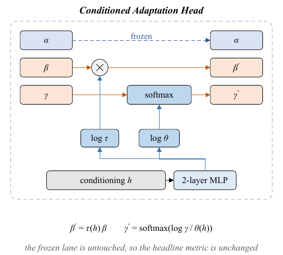</a>
<br><b><code>gated-module</code></b> — <i>"What did you change and what did you freeze?"</i><br>
Adapters, LoRA, FiLM, calibration heads. One frozen lane passes through; the others are modulated by gates. The operators are staggered horizontally so each gate rises straight into the one it drives and <b>no two arrows cross</b>. Single column.</td>
</tr>
</table>

### Real inputs and real predictions — the corpus default

57% of the framework diagrams in the reference corpus embed rasters, and two
thirds of those put images at both ends. These five templates are built around
that.

<table>
<tr>
<td colspan="2"><a href="templates/framework-with-io.yaml">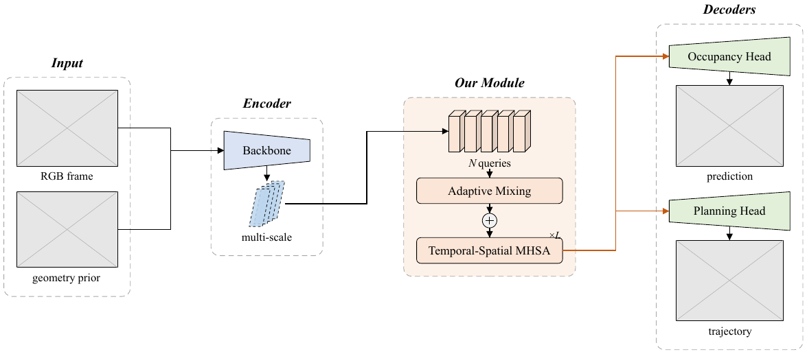</a>
<br><b><code>framework-with-io</code></b> — <i>"What goes in and what comes out?"</i><br>
The dominant shape in the corpus: real crops on the left, the architecture across the middle, real predictions on the right. Point <code>src:</code> at your own frames and renders — <code>image</code> reads the aspect ratio from the file, so you give width only. Double column.</td>
</tr>
<tr>
<td width="50%"><a href="templates/surroundview-pipeline.yaml">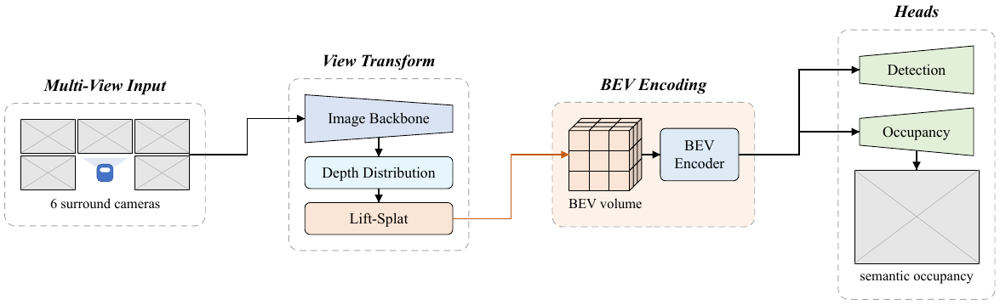</a></td>
<td width="50%"><a href="templates/teacher-student.yaml">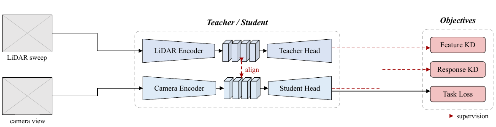</a></td>
</tr>
<tr>
<td><b><code>surroundview-pipeline</code></b><br><i>Multi-camera perception.</i><br><code>cameraring</code> lays six views out the way the nuScenes and Waymo papers do — three forward, three rear, ego glyph between — feeding a <code>voxelgrid</code> BEV volume. Double column.</td>
<td><b><code>teacher-student</code></b><br><i>"How does the student learn from the teacher?"</i><br>Two branches on the same rhythm, distillation losses tied at matched depths rather than one arrow at the end. Double column.</td>
</tr>
<tr>
<td><a href="templates/trainable-frozen.yaml"></a></td>
<td><a href="templates/wrapped-pipeline.yaml">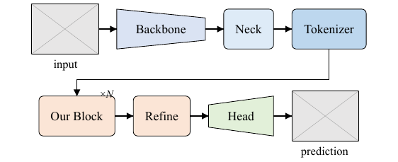</a></td>
</tr>
<tr>
<td><b><code>trainable-frozen</code></b><br><i>"Which parameters move?"</i><br>The flame/snowflake convention, drawn as <b>vector paths rather than pasted emoji</b>, so they stay sharp at 600 dpi and survive PDF/A. Arrow colour follows the marker. Double column.</td>
<td><b><code>wrapped-pipeline</code></b><br><i>A pipeline too long for one row.</i><br>Folded into two bands. The fold leaves the <em>bottom</em> of the upper band and enters the <em>top</em> of the lower one, so the horizontal leg runs through the empty gap instead of straight through the boxes. Single column.</td>
</tr>
</table>

### Analysis, evaluation and position papers — no network to draw

These exist because a measurement paper still has an argument, and the argument
is what the figure has to carry.

<table>
<tr>
<td width="50%"><a href="templates/blindspot-teaser.yaml">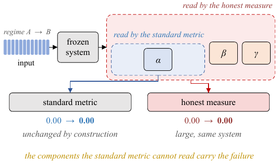</a></td>
<td width="50%"><a href="templates/factorial-2x2.yaml">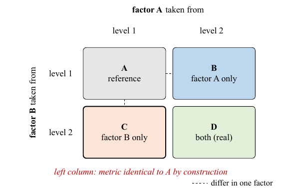</a></td>
</tr>
<tr>
<td><b><code>blindspot-teaser</code></b><br><i>"What can the standard metric not see?"</i><br>The subset relation is drawn as <b>nested regions</b>, so each evaluator needs exactly one arrow and nothing crosses. Page 1, single column.</td>
<td><b><code>factorial-2x2</code></b><br><i>"What did the controlled design isolate?"</i><br>Two factors crossed into four conditions; exactly one cell carries the claim. Single column.</td>
</tr>
<tr>
<td><a href="templates/study-overview.yaml">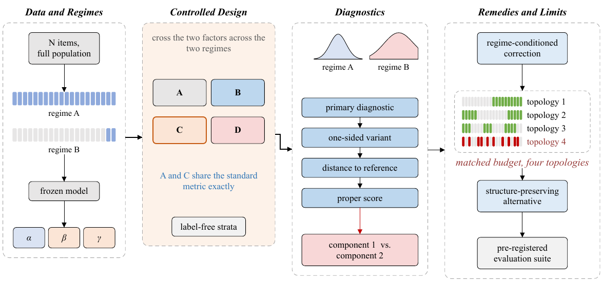</a></td>
<td><a href="templates/taxonomy.yaml">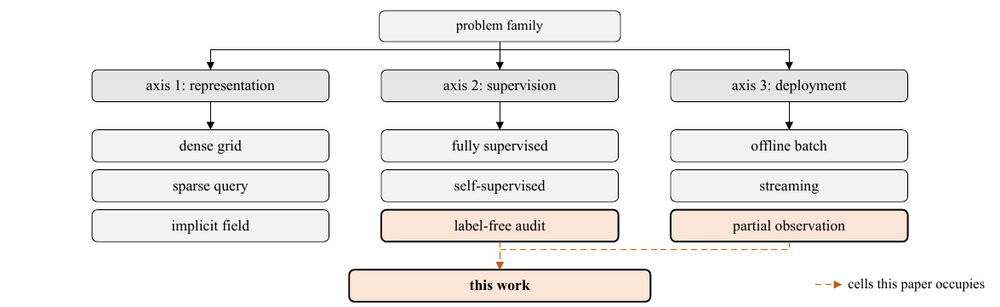</a></td>
</tr>
<tr>
<td><b><code>study-overview</code></b><br><i>"What is the shape of the study?"</i><br>Data and regimes → controlled design → diagnostics → remedies <i>and their limits</i>. Double column.</td>
<td><b><code>taxonomy</code></b><br><i>"Where does this sit in the field?"</i><br>A partition with only the occupied cells coloured. Intro / related work, double column.</td>
</tr>
</table>

Full rules for each, including the characteristic failure mode, are in
[`references/archetypes.md`](references/archetypes.md).

---

## Output formats

```bash
python3 scripts/render.py spec.yaml -o build/fig \
        -f svg,pdf,png,tiff,emf,vsdx,pptx --dpi 600
```

| Format | Written by | Editable as |
|---|---|---|
| `.svg` | bundled | Illustrator, Inkscape, Figma, Affinity, browsers |
| `.vsdx` | **bundled** | **Visio, natively — no ungroup step** |
| `.pptx` | **bundled** | **PowerPoint, natively; pastes into Visio as shapes** |
| `.pdf` | whichever converter is present | LaTeX `\includegraphics`, Illustrator |
| `.png` / `.tiff` | rasterised from the PDF at `--dpi` | slides, rebuttals, posters |
| `.emf` | Inkscape or LibreOffice | Word, and Visio import + ungroup |

### About resolution

Rasters are **always taken from the PDF**, never straight from the SVG.
LibreOffice's PNG filter silently ignores the requested density and emits a
96 dpi screenshot — a 600 dpi request used to produce a 317 px image. So
`render.py` rasterises the PDF with a tool that honours a density flag, then
**verifies the produced pixel count against `--dpi`** and warns if a converter
cut the corner:

```
png via pdftoppm @600 dpi -- 4200 x 1857 px
```

Use **600 dpi** for camera-ready and **1200 dpi** for a poster.

---

## Editing the output: Visio, PowerPoint, Illustrator

Every module in `build/fig.vsdx` is a **real Visio shape** with its own
geometry, fill, line and character sections:

- click a box and the Format Shape pane shows the fill as `#FFE699`;
- drag a vertex and the geometry updates — no ungroup;
- edit the text in place and it stays 7 pt Times New Roman;
- arrows are polylines with `EndArrow=4`, so their waypoints are draggable.

> **Raster panels.** `image` nodes export to `.vsdx` as labelled placeholder
> rectangles, and the render report lists the files it skipped. Use `.pptx` if
> you want the crops embedded for you, or drop them in by hand with
> *Insert → Pictures*.

### The module stencil

Prefer not to write YAML at all? Generate a drag-and-drop palette:

```bash
python3 scripts/make_stencil.py -o build/stencil -f vsdx,pptx
```

<p align="center">
  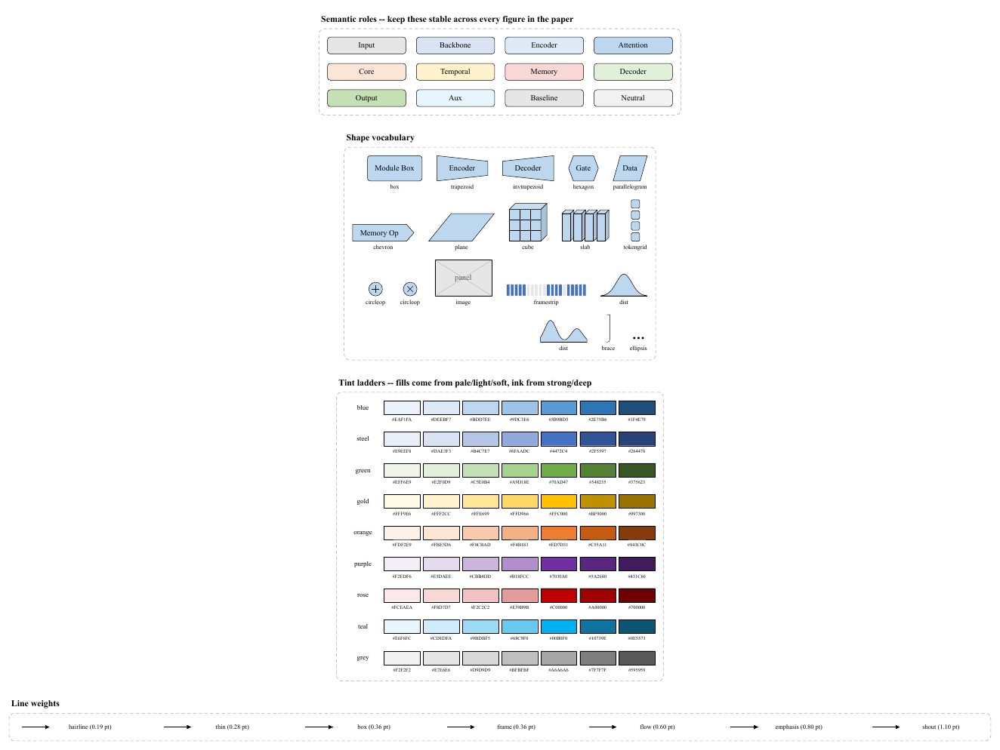
</p>

Keep it open in a second window and copy modules across. They arrive already
carrying the house fill, outline, corner radius and 7 pt Times label.

Full round-trip notes in [`references/visio-workflow.md`](references/visio-workflow.md).

---

## The auditor

```bash
python3 scripts/validate.py spec.yaml --svg build/fig.svg [--strict] [--json]
```

About forty checks; the full table is in
[`references/anti-ai-checklist.md`](references/anti-ai-checklist.md). The
ones that matter most:

| Code | Level | What it catches |
|---|---|---|
| `text-too-small` | error | any text under 6.0 pt **at final printed size** (6.5 pt warns; module names ≥ 7.0) |
| `undefined-symbol` | error | a symbol defined neither in a label nor in the caption |
| `symbol-not-in-caption` | error | `defined_in: caption`, but the caption never writes it |
| `legend-unused-entry` | error | a legend entry nothing in the figure uses |
| `short-final-segment` | error | a bent arrow whose last run is too short — WPS draws the head at 45° |
| `corridor-too-narrow` | error | a gap too narrow for the wires that jog in it |
| `ai-palette` | error | Tailwind / Material / Bootstrap stock colours |
| `image-low-ppi` | error | an embedded crop under 300 ppi at print size (600 warns) |
| `label-overflow` / `node-overlap` | error | text wider than its box, overlapping modules |
| `text-off-canvas` / `edge-off-canvas` | error | anything LaTeX would crop |
| `inconsistent-role` | error | one concept drawn in two different fills |
| `upright-variable` | warning | `z_t` upright in the figure, italic in the text |
| `unexplained-line-style` | warning | a dashed or coloured arrow in no legend and unlabelled |
| `edges-share-corridor` | warning | two wires that read as one |
| `edge-crosses-node` / `edge-crosses-text` | warning | an arrow through a module, caption or title |
| `saturated-fill` / `tinted-outlines` | warning | the UI-kit card look |

Exit code is non-zero on any error, or on any warning with `--strict` — so it
drops straight into CI or a pre-commit hook.

### After the hand-over

The spec is not what ships. Once the PPTX has been edited it is the only
source; audit it, and the PDF made from it:

```bash
python3 scripts/audit_pptx.py fig.pptx --width 496.8 --spec spec.yaml   # any PPTX, FigGenie's too
python3 scripts/audit_pptx.py fig.pptx --width 496.8 --fix fig_fixed.pptx   # theme shadows, detached subscripts
python3 scripts/export_pptx.py fig.pptx --width 496.8                   # lossless PDF + audit
python3 scripts/audit_pdf.py   fig.pdf  --width 496.8
```

On the hand-edited overview figure of a real submission, `audit_pptx.py`
reported exactly the three defects that had reached the PDF: two bent arrows
WPS drew at 45° (last runs of 2.5 and 3.5 pt), twenty subscripts flattened to
plain text (`z1:4`, `O5:10`, `d1`…), and a legend entry for an arrow that
had been deleted. See
[`references/after-handover.md`](references/after-handover.md).

The auditors cannot judge whether the figure *communicates*. Render a PNG and
look at it.

---

## Putting it in the paper

The engine lays out in **final rendered points**, and `venue` + `width` set the
canvas to the exact column width. So:

```latex
\begin{figure*}[t]
  \centering
  \includegraphics[width=\linewidth]{figures/overview.pdf}
  \caption{\textbf{Overview of X.} <the claim>. <the parts, left to right>.}
  \label{fig:overview}
\end{figure*}
```

renders at 100 %, and `size: 7.5` in the spec is 7.5 pt on the page.

Want it at 80 % of the column? Set `width_frac: 0.8` **in the spec** and keep
`width=\linewidth` in LaTeX. Writing `width=0.8\linewidth` instead shrinks your
type to 6.0 pt.

The caption states the claim, names the parts, explains the colours and
defines every symbol the figure shows — then recompile, because a caption one
line longer moves the text after it. The PDF must be lossless; `render.py` and
`export_pptx.py` take care of that, `audit_pdf.py` confirms it.

| Venue | `\columnwidth` | `\textwidth` |
|---|---|---|
| CVPR / ICCV / WACV | 237.13 pt | 496.85 pt |
| ECCV (LNCS) | 347.12 pt | 347.12 pt |
| NeurIPS / ICLR | 397.48 pt | 397.48 pt |
| ICML | 234.88 pt | 487.82 pt |
| AAAI | 238.49 pt | 504.00 pt |
| ACL / EMNLP | 219.08 pt | 455.24 pt |

More, including float placement and camera-ready checks, in
[`references/latex-integration.md`](references/latex-integration.md).

### Keeping figures reproducible

```
figures/
  overview.pdf          <- what LaTeX includes
  overview.pptx         <- what you hand a co-author
  src/overview.yaml     <- the spec, committed
  src/crops/*.png       <- the real data panels
```

```bash
for f in figures/src/*.yaml; do
  python3 scripts/render.py "$f" -o "figures/$(basename "${f%.yaml}")" \
          -f svg,pdf,pptx --dpi 600
done
```

---

## Repository layout

```
SKILL.md                  Claude Code entry point (frontmatter routing)
AGENTS.md                 Codex / other-agent entry point
manifest.yaml             which fragment to load for which job
install.sh                one-command install as a Claude Code skill

static/core/
  stance.md               the non-negotiables and the list of tells
  contract.md             the eight questions to answer before drawing

references/
  corpus-report.md        every measurement, with the rules that were cut
  house-style.md          the measured palette, type and strokes — and the method
  spec-language.md        the full spec grammar
  archetypes.md           the archetypes and what makes each one work
  from-code.md            drafting from source: what it infers, where it is wrong
  case-studies.md         published figures taken apart
  anti-ai-checklist.md    the automated checks plus the eye pass
  visio-workflow.md       Visio / PowerPoint / Illustrator editing
  latex-integration.md    sizing, floats, captions, lossless export, camera-ready
  symbols-and-captions.md maths in labels, the symbol table, the caption
  after-handover.md       auditing the edited PPTX and the exported PDF
  app-compatibility.md    WPS / Keynote / LibreOffice / PowerPoint, measured

scripts/
  render.py               spec -> svg / pdf / png / tiff / emf / vsdx / pptx
  from_code.py            PyTorch source or mmdet config -> spec
  validate.py             the auditor (spec)
  audit_pptx.py           the auditor for any PPTX, after hand edits
  audit_pdf.py            the auditor for the PDF LaTeX includes
  export_pptx.py          lossless PPTX -> PDF (LibreOffice or Keynote)
  make_stencil.py         the module palette generator
  cvprfig/                the engine (standard library only)
    palettes.py           the three measured colour systems, kept apart
    style.py              typography, strokes, geometry, roles
    text.py               baked Adobe Core-14 metrics, inline markup, maths, symbols
    ooxml.py              reads any PPTX back: paths, runs, pictures, glue
    imgsize.py            PNG/JPEG/GIF/PDF dimensions, no dependencies
    imgcolor.py           legend colours inside pictures, shading-aware (Pillow or PyMuPDF)
    layout.py             the box-model solver
    edges.py              orthogonal routing, final runs, lanes
    shapes.py             the shape vocabulary
    svg.py vsdx.py pptx.py   three renderers over one layout
    miniyaml.py           dependency-free YAML subset parser
    code2fig/             graph IR, two source readers, spec emitter
      graph.py            the IR, role inference, pruning, branch colouring
      torchscan.py        nn.Module source -> graph, via ast
      mmconfig.py         mmengine/mmdet config -> graph, via ast
      emit.py             graph -> spec, with the column-fitting ladder

templates/                sixteen archetypes + stencil.vsdx / stencil.pptx
examples/quickstart.yaml  the 50-line example above
assets/gallery/           rendered previews
tests/test_engine.py      regression checks (engine, exporters, auditors, code2fig)
tests/compat/             optional: LibreOffice round trip of every PPTX route
```

---

## Tests

```bash
python3 tests/test_engine.py
```

212 checks, no dependencies, a few seconds. They cover text metrics against a
published box width, the bundled YAML parser (byte-identical output to PyYAML),
layout snapping, port-normal routing, colour and named-stroke resolution, nested
container forms, every shape, all sixteen templates rendering *and passing the
auditor*, `.vsdx` / `.pptx` package structure and shape counts, raster embedding
and real-aspect sizing, both code readers end to end (submodules, dataflow
edges, branch survival, plumbing pruning, role inference, config annotations),
the column-fitting ladder, the auditor's own positive and negative cases, and
for v3: maths typesetting and spacing, symbol extraction, the symbol and
legend checks, final-run and lane guarantees, connector geometry round-tripped
through the PPTX reader for 24 routes in four rotations, `paper.yaml`,
`type_scale`, `align_x`, image ppi, and `audit_pptx.py` catching flattened
subscripts and orphaned legend entries.

`python3 tests/compat/lo_roundtrip.py` (needs LibreOffice and PyMuPDF) opens
every template's PPTX in LibreOffice and checks that all 159 glued arrows are
drawn exactly where the engine routed them.

CI runs them on Python 3.9, 3.11 and 3.13 with **nothing installed**, so a
regression that introduces a dependency fails the build.

---

## FAQ

<details>
<summary><b>Can it draw bar charts, curves, heatmaps or ablation plots?</b></summary>

No, and it will tell you so. Those are matplotlib/seaborn work. This project is
for the figures matplotlib is bad at: architecture diagrams, pipelines, teasers,
module zoom-ins, taxonomies.
</details>

<details>
<summary><b>Does it use an image model?</b></summary>

No. Nothing is generated by diffusion or by an LLM drawing SVG coordinates —
both produce exactly the generic look this project exists to prevent. A
deterministic solver computes every coordinate, so the same spec always gives
the same figure, and a diff of the spec is a diff of the figure.
</details>

<details>
<summary><b>Will it invent my results?</b></summary>

No. `image` nodes without a `src` render as **deliberately obvious** labelled
placeholders, so an unfinished figure cannot be mistaken for a finished one, and
the render report lists which slots are still empty.
</details>

<details>
<summary><b>My figure is too wide. What now?</b></summary>

The renderer scales it down and tells you the *effective* point size:

```
WARNING: Layout is 539.6 pt wide but the target column is 504.0 pt,
         so the figure is scaled to 93%; body labels render at ~6.5 pt.
```

Below 6.0 pt that becomes an error. The fix is to shorten labels, drop a stage,
or split the figure — not to accept the shrink.
</details>

<details>
<summary><b>Can I edit the <code>.vsdx</code> and get the spec back?</b></summary>

No — there is no reverse parser. Treat the spec as the master while the
structure is still moving, and switch to editing the `.vsdx` or `.pptx` only
once the layout has settled.
</details>

<details>
<summary><b>Fonts look wrong after conversion.</b></summary>

The SVG names `Times New Roman, Nimbus Roman, Liberation Serif, Times, serif` so
it degrades sensibly, but converters substitute at their own discretion. Check
with `pdffonts build/fig.pdf`; for exact metrics convert with Inkscape and
`--export-text-to-path`.
</details>

<details>
<summary><b>How do I match a specific paper's style?</b></summary>

Read its palette straight out of the published PDF — the method is at the top of
[`references/house-style.md`](references/house-style.md) — then write a spec
with those colours. [`references/case-studies.md`](references/case-studies.md)
takes five well-known figures apart idiom by idiom.
</details>

<details>
<summary><b>Two things share a name but must be different colours.</b></summary>

Usually the right fix is to name them apart — real dual-branch figures write
`encoder f_θ` and `encoder f_ξ`, not `encoder` twice. When the contrast really is
the point, set `same_label_ok: true` on the node to silence that one check.
</details>

---

## Reference corpus and attribution

The style constants were measured from the vector content of these published
papers' PDFs. Only typographic parameters were extracted — palette, type sizes,
stroke weights, geometry. **No graphical content was copied**, and everything in
`assets/gallery/` was rendered by this project's own templates.

| Paper | Venue |
|---|---|
| SparseWorld: A Flexible, Adaptive and Efficient 4D Occupancy World Model | arXiv:2510.17482 |
| GaussianWorld: Gaussian World Model for Streaming 3D Occupancy Prediction | CVPR 2025, arXiv:2412.10373 |
| EmbodiedOcc: Embodied 3D Occupancy Prediction | arXiv:2412.04380 |
| StreamVGGT: Streaming Visual Geometry Transformer | arXiv:2507.11539 |
| TPVFormer: Tri-Perspective View for 3D Semantic Occupancy Prediction | CVPR 2023, arXiv:2302.07817 |

The measurement method and the full numbers are in
[`references/house-style.md`](references/house-style.md), so you can repeat it on
any paper whose figures you admire.

---

## Contributing

Issues and pull requests are welcome. Please make sure
`python3 tests/test_engine.py` passes and that any new template renders with
**zero auditor errors** — CI checks both.

Especially useful:

- **new archetypes** for fields this does not cover yet (NLP, speech, RL,
  theory, robotics systems);
- **venue widths** verified against a real `\the\columnwidth`;
- **house-style measurements** from other labs' figures.

## Licence

[MIT](LICENSE) © 2026 Zhao Liu.

Free to use in your papers, commercially, and to redistribute. No attribution
required beyond the licence notice — though a star, or a mention if the figures
helped, is always appreciated.
