<h1 align="center">Method-Figure</h1>

<p align="center">
  <a href="README.md"><b>English</b></a>
  &nbsp;|&nbsp;
  <b>简体中文</b>
</p>

<p align="center">
  <b>面向 AI 顶会论文的 pipeline / 框架图 / teaser 图生成 skill。</b><br>
  写一份简短的 spec，得到一张 <b>Visio 和 PowerPoint 原生可编辑</b> 的图，
  外加给 LaTeX 用的 PDF 和 600 dpi 高清 PNG。
</p>

<p align="center">
  <a href="#快速开始">快速开始</a> ·
  <a href="#安装">安装</a> ·
  <a href="#模板库">模板库</a> ·
  <a href="#编辑输出visiopowerpointillustrator">Visio</a> ·
  <a href="#审计器">审计器</a> ·
  <a href="#常见问题">常见问题</a>
</p>

<p align="center">
  <a href="https://github.com/ChizkiyahuOhayon/Method-Figure/actions/workflows/test.yml"></a>
  
  
  
  
</p>

<p align="center">
  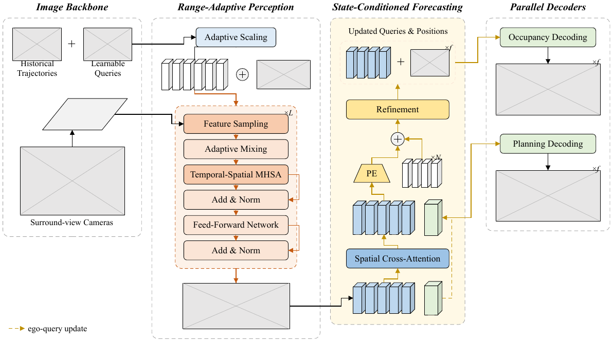
</p>

---

## v3 新变化

**3.1** 修复了用 3.0 审计这篇投稿全部 17 张图时发现的三个问题：
- 漏报了从主题继承的阴影。即使形状写了空的 `<a:effectLst/>`，LibreOffice 也照样画出
  阴影，PowerPoint 和 Keynote 则不显示。FigGenie 导出的 PPTX 里有 139 个这样的形状，
  现在报为 error。
- 占用预测图的类别图例被误报为"孤立图例"。审计器现在会去嵌入图片里找这些颜色，并且
  计入明暗不同的着色。
- 放大后的下标在 LibreOffice 里被压得过低。引擎写入的偏移现在能让下标保持在正文字号
  的 0.20 倍处；手工放大的下标由 `script-too-low` 检查。

`audit_pptx.py --fix` 会对第一和第三个问题直接生成修好的副本。

v3 来自把 v2.0 用在一篇真实 CVPR 投稿上的经验：出问题的地方全都在图离开引擎**之后**——
在手动改过的 PPTX 里，以及从它导出的 PDF 里。

- **审计跟着文件走。** `audit_pptx.py` 可以审计任何被手动修改过的 PPTX（WPS、PowerPoint、
  Keynote 改过的都行，FigGenie 生成的 PPTX 也行）：会被 WPS 画成 45° 的拐弯箭头、丢失的
  上下标、指向已删除元素的图例项、没有粘在框上的箭头、印出来太小的字、分辨率不足的图片、
  会被栅格化的阴影特效。`audit_pdf.py` 审计 LaTeX 实际引用的 PDF；`export_pptx.py` 做无损
  导出——LibreOffice 默认设置曾把一张 4000 ppi 的图降成了 298 ppi 的 JPEG。
- **每个符号都要有定义。** 标签支持 LaTeX 数学写法（`$z_{1:4}$`、`$\tilde c_s$`、
  `$N \times C$`），变量斜体、运算符间距都和正文一致。`symbols:` 符号表和图注（可以直接写
  在 spec 里，也可以从论文 `.tex` 里读）会被逐一核对：既没在图中文字里写明、也没在图注里
  定义的符号直接报错。同一篇论文的所有图共用一个 `paper.yaml`，配色和符号写法不会漂移。
- **字更大。** 模块标签 7.5 pt，标题 8.5 pt——取自大家想模仿的那几篇论文（SparseWorld、
  Occ3D、BEVDepth）的实测中位数。下限 6.0 pt，模块名不低于 7.0 pt。`type_scale` 可以
  一次性整体放大。
- **去掉"AI 感"。** Tailwind / Material / Bootstrap 的默认色直接报错，高饱和填充和同色描边
  会被标出；贡献模块用暖橙色，输出用绿色，沿用的部分用灰色。
- **经得起手动修改的箭头。** PPTX 里的箭头是真正粘在框上的 Office 连接线——挪动模块，
  箭头跟着走。拐弯箭头的最后一段永远够长，WPS 不会画歪；平行的线各走各的通道；空隙不够
  时引擎会把空隙撑宽，而不是把线挤在一起。SVG 和 PPTX 的箭头大小按"最终导出 PDF 的软件"
  对齐。
- **在四个软件里实测过。** 同一个文件在 WPS、Keynote、LibreOffice、PowerPoint 里各有什么
  差异，见 [`references/app-compatibility.md`](references/app-compatibility.md)。

完整列表见 [`CHANGELOG.md`](CHANGELOG.md)。

---

## 为什么要做这个

AI 生成的框架图不是"丑"，而是**通用**。审稿人一秒就能认出来：

| AI 味的特征 | 真实顶会图的做法 |
|---|---|
| 高饱和彩虹配色，一个框一个颜色 | 3–5 种淡色调，每种只承载一个语义 |
| 投影、渐变、毛玻璃 | 纯平填充，一条黑色发丝描边 |
| 齿轮、大脑、云朵、闪光、emoji | 张量画成立体卡片，编码器画成梯形 |
| 方框里塞整句话 | 名词短语，不超过 6 个词 |
| 每个框一样大，排成完美网格 | 宽度承载重要性 |
| 飘着的曲线箭头，端点没对准 | 沿端口法向的正交走线 |
| 全篇没有一张真实数据 | 输入截图和输出渲染，直接嵌进去 |
| "图 1：所提出框架的总览。" | caption 陈述一个论断 |

上面每一条都是**默认行为**。`Method-Figure` 的做法不是"提示模型别这么画"，而是**把这些默认从引擎里拆掉**：

- 配色、字号、线宽、圆角、内边距，全部是用 PyMuPDF **从 349 张已发表论文配图 PDF 的矢量内容里量出来的**，不是自己编的——完整的证据链，包括三条因证据不足而被砍掉的规则，在 [`references/corpus-report.md`](references/corpus-report.md)；
- 版面由确定性求解器计算，**单位是最终印刷磅值**——spec 里写 `size: 7.5`，纸上就是 7.5 pt，不需要心算；
- 箭头被**强制**沿端口法向进出、直角转折；
- 交付前必须过**审计器**，它会把上面那些特征逐条点名。

### 决定了这套风格的几个发现

v2 用一个更大的语料库把每一个常量重新推导了一遍：**46 篇**有完整 arXiv 源码的论文，
来自三个本项目想要靠近的组——清华 MARS、郑文钊组、旷视 Megvii——覆盖 **292 个 figure
环境**和 **349 张配图 PDF**，全部用 PyMuPDF 读取。

**几乎没人用 TikZ 画图。** 290 张图里只有 1 张用了 `tikzpicture`，而且是个消融柱状图。
所有架构图无一例外都是外部矢量稿，用 `\includegraphics` 放进去，其中 86% 是**单个文件**
——拼版发生在绘图软件里，不在 LaTeX 里。嵌入的字体表直接说明了是什么软件：Calibri 和
Cambria Math（PowerPoint / Visio）、Segoe Print（Windows）、手动设置的 Times New Roman
PS MT。所以"生成原生 `.pptx`/`.vsdx` + Office 色卡"不是一种审美偏好，而是在**复现真实的
生产流程**。

**配色是三套取色板，不是一套。** 有 101 种颜色出现在四张以上不同的图里，它们干净地
分解成三组：Office 2013+ 主题阶梯、diagrams.net 的默认样式（它是成对的
填充/描边，**不能拆开**）、以及只出现在数据图里的 matplotlib `tab10`。`palettes.py`
把三套各自保持完整，不做混合：

```
#DEEBF7 #BDD7EE #9DC3E6 #5B9BD5 #2E75B6   Office Blue Accent 5，一模一样
#E2F0D9 #C5E0B4 #A9D18E #70AD47 #548235   Green Accent 6
#FFF2CC #FFE699 #FFD966 #FFC000 #BF9000   Gold Accent 4
#DAE8FC / #6C8EBF   #D5E8D4 / #82B366     draw.io 的成对样式——不要拆
描边：全部描边长度的 45% 是纯 #000000
```

**字号比所有人以为的都小。** 把每张图自己的"画布→栏宽"缩放系数（中位数 0.385）算进去
之后，最终印在纸上的字号中位数是 **6.0 pt**，四分位是 4.5 和 7.5；每张图里**最小**那个
字号的中位数是 5.4 pt。v2.0 把下限定在这里——结果按这个字号做出来的图读起来偏小。v3
重新测量了大家真正想模仿的论文（SparseWorld 的 Visio 总览图印刷字号中位数 7.5 pt，Occ3D
8.2 pt，BEVDepth 8.6 pt），改为 7.5 pt 标签、6.0 pt 下限。同一次扫描还暴露出 v1 的线宽
**大约粗了一倍**：实测的印刷线宽众数是 0.19、0.36、0.45、0.80 pt。

**框架图里有真实数据。** 57% 的架构图至少嵌了一张位图——中位数 **11 张**、占画布约四分之一
——而且这些图里 **66% 在最左和最右两端都放了图像**。输入进去，预测出来，架构在中间。
这就是 `image`、`imagegrid`、`cameraring` 存在的原因，也是 `image` 会从真实文件读取宽高比
的原因，更是审计器会提醒"纯方块 pipeline 图"的原因。

---

## 快速开始

零依赖、免安装。clone 下来直接出图：

```bash
git clone https://github.com/ChizkiyahuOhayon/Method-Figure.git
cd Method-Figure

python3 scripts/render.py examples/quickstart.yaml -o build/quickstart \
        -f svg,pdf,png,pptx,vsdx --dpi 600
```

```
wrote build/quickstart.svg
wrote build/quickstart.pdf
wrote build/quickstart.png
wrote build/quickstart.pptx
wrote build/quickstart.vsdx
  pdf via libreoffice (lossless)
  png via pdftoppm @600 dpi -- 4146 x 1544 px
  pptx: 44 shapes, 0 embedded image(s), 8 glued connector(s)
  pdf audit: 0 error(s), 0 warning(s)
  canvas 496.8 x 184.9 pt | 10 nodes | 8 edges | scale 1.000
```

<p align="center">
  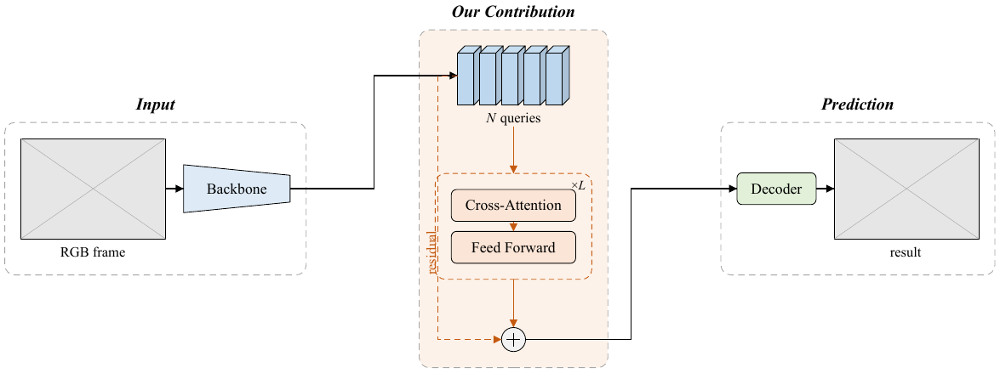
</p>

这张图来自 [`examples/quickstart.yaml`](examples/quickstart.yaml)，约 50 行。
用 PowerPoint 打开 `build/quickstart.pptx`、或用 Visio 打开 `build/quickstart.vsdx`，
拖一下方框试试：**每个元素都是原生形状，不需要"取消组合"**，而且箭头是粘在框上的：
在 PowerPoint 或 WPS 里挪动方框，箭头会跟着走。

然后检查它：

```bash
python3 scripts/validate.py examples/quickstart.yaml --svg build/quickstart.svg
# WARN empty-image-slot  2 image slot(s) have no `src` ...
# 0 error(s), 1 warning(s), 0 note(s) | 497 x 185 pt | 10 nodes
```

唯一的 warning 是实话：两个图片位在你放入真实截图之前都只是占位框。

手动改过 PPTX 之后，要审计真正交付的文件，而不是 spec：

```bash
python3 scripts/audit_pptx.py build/quickstart.pptx --width 496.8 --spec examples/quickstart.yaml
python3 scripts/export_pptx.py build/quickstart.pptx --width 496.8   # 无损导出 PDF，并自动审计
```

---

## 安装

### 作为 Claude Code skill（推荐）

```bash
git clone https://github.com/ChizkiyahuOhayon/Method-Figure.git
cd Method-Figure
./install.sh              # -> ~/.claude/skills/method-figure   （全局，所有项目可用）
./install.sh --project    # -> ./.claude/skills/method-figure   （只在当前项目）
```

安装脚本会复制 skill、跑一遍自检、并报告找到了哪些可选转换器。

> 项目名是 **Method-Figure**，但装好的 skill id 是小写的 `method-figure`——
> Claude Code 的 skill id 规定是小写连字符，所以斜杠后面要敲小写。

之后直接用自然语言提要求：

> 读一下 `method.tex`，给 CVPR 投稿画一张通栏的 overview 图。
> 导出 LaTeX 用的 PDF，再给我一份可编辑的 `.vsdx`。

Claude Code 会加载 [`SKILL.md`](SKILL.md)，填图表契约、选原型、写 spec、渲染、审计，最后把 LaTeX 代码块给你。也可以用 `/method-figure` 显式调用。

### 配合 Codex / Cursor / Aider / 自建 API 循环

把 agent 指向 [`AGENTS.md`](AGENTS.md)——同样的指令，去掉了 Claude Code 的路由元数据：

```bash
git clone https://github.com/ChizkiyahuOhayon/Method-Figure.git third_party/Method-Figure
# 然后在你的 AGENTS.md / .cursorrules / system prompt 里写：
#   "任何框架图、pipeline 图、teaser 图、模块图，
#    都遵循 third_party/Method-Figure/AGENTS.md。"
```

`agents/openai.yaml` 里有给相应宿主读取的显示名和默认 prompt。

### 不用 agent，手动使用

引擎就是一个普通命令行工具。复制最接近的模板、改 YAML、渲染。
语法全在 [`references/spec-language.md`](references/spec-language.md)。

### 环境要求

| | |
|---|---|
| **必需** | Python 3.8+。仅此而已——引擎只用标准库 |
| **可选** | PyYAML（没装时用内置解析器，输出逐字节一致） |
| **出 `.pdf`** | Inkscape / LibreOffice / `rsvg-convert` / CairoSVG 任一 |
| **出 `.png` / `.tiff`** | `pdftoppm`（poppler-utils）或 ImageMagick |
| **出 `.emf`** | Inkscape 或 LibreOffice |
| **交付后审计** | PyMuPDF（`audit_pdf.py`）；在图片里找图例颜色需要 Pillow 或 PyMuPDF |

`.svg`、`.vsdx`、`.pptx` 由内置代码直接写出，**永远可用**。

<details>
<summary>安装可选转换器</summary>

```bash
# macOS
brew install --cask inkscape libreoffice
brew install poppler imagemagick

# Debian / Ubuntu
sudo apt install inkscape libreoffice-draw poppler-utils imagemagick librsvg2-bin

# 最小配置：poppler + librsvg 就够出 PDF 和高清 PNG
```
</details>

---

## 工作流程

三步。skill 会带着 agent 走完这三步；手动使用也是同样三步。

### 1. 图表契约——动笔前先答题

[`static/core/contract.md`](static/core/contract.md) 里有八个问题（含符号表），第一个最关键：

> 这张图要让读者相信：______________________

如果这句话需要一个"并且"，说明它是两张图。如果写的是*"这是我们方法的架构"*——那是描述不是论断，画出来必然没有重点。

同时还要定：原型、哪一个元素是核心贡献、语义配色表、会场与栏宽、哪些真实截图会填进 image 槽位。

### 2. 写 spec——只写语义，不写像素

你说明**什么东西按什么顺序放在哪里**，几何由引擎算。

```yaml
figure: {id: overview, venue: cvpr, width: double, font: times}

layout: row
gap: 14

panels:
  - id: s_core
    title: "Our Contribution"          # 粗斜体，位于虚线容器上方
    frame: dashed
    fill: orange.pale
    body:
      - {id: q, shape: slab, n: 5, cell: 8, cellh: 26, role: attention,
         caption: "$N$ queries"}                # 数学写法：变量斜体，和正文一致
      - group:                          # 带重复次数角标的着色子区域
          id: blk
          frame: region
          frame_color: orange.deep
          badge: "$\\times L$"
          body:
            - {id: b1, text: "Cross-Attention", role: core}
            - {id: b2, text: "Feed Forward",    role: core, tint: light}

edges:
  - {from: q, to: blk, color: orange.deep}
  - {from: q.w, to: sum.w, route: bus, bend: 10, dash: true, label: "residual"}

symbols:                                # 图里出现的每一个符号
  "N":       {meaning: "number of queries", defined_in: figure}
  "L":       {meaning: "number of decoder layers", defined_in: caption}
  "\\oplus": {meaning: "element-wise addition", defined_in: caption}

caption: >-                             # 或 caption_tex: sec/3_method.tex#fig:overview
  \textbf{Learnable queries read the image once per layer.} $N$ queries
  cross-attend in each of $L$ layers and are added back ($\oplus$).
```

有两个特性承担了绝大部分"看起来像手工排版"的效果：

- **等尺寸吸附**——列里的方框类兄弟节点吸附到最宽者，行里吸附到最高者，于是一摞模块自然落在网格上；
- **端口法向路由**——不管你指定什么走线方式，线一定沿源端口法向离开、沿目标端口法向进入，只走直角。箭头永远不会平贴着边缘扎进去，而且拐弯后的最后一段永远够长，任何软件都能把箭头画正。

### 3. 审计——交付之前

```bash
python3 scripts/validate.py spec.yaml --svg build/fig.svg
```

`FAIL` 必须清零，`WARN` 要么修要么给出理由。然后做
[`references/anti-ai-checklist.md`](references/anti-ai-checklist.md) 里的人眼复核：
眯眼测试、用手指顺一条通路、盖住 caption、转灰度。

---

## 根据代码出图

把它指向一份模型实现，直接拿到一份 spec 初稿。**全程不 import、不执行**——两个 reader
都用 `ast` 解析，所以不需要装依赖、不需要下载权重、不需要 CUDA。

```bash
# 这个包里有哪些模型类？
python3 scripts/from_code.py bevdepth/layers/ --list

# 画其中一个
python3 scripts/from_code.py bevdepth/layers/ --model DepthNet -o fig.yaml
python3 scripts/render.py fig.yaml -o build/depthnet -f svg,pdf,pptx
```

<p align="center">
  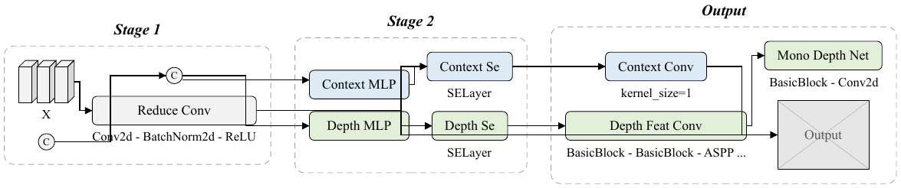
</p>

这是 BEVDepth 里的 `DepthNet`，没有任何手工编辑。reader 从 `forward` 里恢复了两条并行
分支，把 `nn.Sequential` 的内容提到了 caption 里，剪掉了 norm/dropout 这类管道模块，
并且因为模块名无法推断语义角色，就按**分支**给它们上了不同的颜色。

如果代码带 **mmengine / mmdet / mmdet3d 的 config**，优先用它——config 按 pipeline 顺序
写明了每一个 stage 和通道数，比类继承关系好得多：

```bash
python3 scripts/from_code.py configs/model.py --mm -o fig.yaml
```

### 它会自己把图塞进栏宽

草稿一旦超出栏宽，渲染时就会被静默缩放，而缩放正是图上出现 5 pt 小字的直接原因。所以
emitter 会先量自己的草稿，然后按顺序改形，并把每一步让步都报告出来：

```
$ python3 scripts/from_code.py configs/sparseworld.py --mm -o fig.yaml
  7 nodes, 6 edges, 7 layers from BEVStereo4DOCC
  fit: dropped channel captions; abbreviated module names;
       dropped 1 peripheral modules to fit the column
```

顺序是：去掉通道数 caption → 按语料库的写法缩写名字（`img_bev_encoder_backbone` →
`BEV Enc. Backbone`）→ 砍掉连接度最低的方块 → 实在不行才折成两行（并带一个正确的回折
箭头）。

### 它是初稿，不是答案

reader 能把模块、顺序、分支结构搞对，但它**不知道哪一个是你的贡献**。交付前你需要：

- 把方块改成**论文里**用的名字，不是属性名；
- 删掉论文没讨论的东西——语料库里框架图的中位数是 **11** 个方块；
- 给输入输出槽位挂上真实的 `src:` 图；
- 拿 `forward` 核对跨分支的箭头；
- 给贡献模块标上 `role: core`，并单独给它一个 panel。

已知的局限都写下来了，没有含糊：[`references/from-code.md`](references/from-code.md)
列出了 reader 会拍平什么（`if` 的两个分支都会画出来）、看不见什么（functional 调用、
config 的 `_base_` 继承）、以及靠猜的部分（`for blk in self.blocks` 变成 `×N`，因为
源码里没有这个数）。

---

## 模板库

复制最接近的那个，然后替换内容。从空白 spec 开始既费劲，又会丢掉让这个原型成立的比例关系。

一篇论文通常需要**一张 teaser 类 + 一到两张其他**。需要第三张框架图，几乎总是说明方法本身没拆干净。

### 架构类论文——贡献是一个模型

<table>
<tr>
<td width="50%"><a href="templates/pipeline-4stage.yaml"></a></td>
<td width="50%"><a href="templates/teaser-comparison.yaml">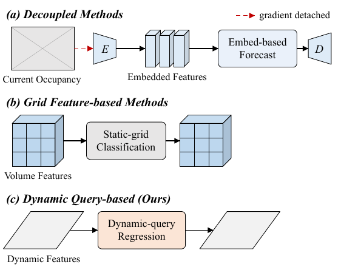</a></td>
</tr>
<tr>
<td><b><code>pipeline-4stage</code></b><br><i>"整个流程有哪些部件？"</i><br>3–5 个虚线阶段容器，贡献所在阶段加淡色底，每阶段箭头一个颜色。双栏。</td>
<td><b><code>teaser-comparison</code></b><br><i>"这不就是 X 吗？"</i><br>范式行 (a)(b)(c…Ours) 共用同一套配色，让读者只看到算子变了。第 1 页，单栏。</td>
</tr>
<tr>
<td><a href="templates/module-detail.yaml">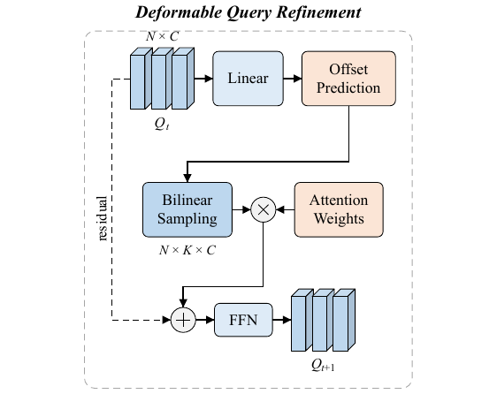</a></td>
<td><a href="templates/attention-tokens.yaml">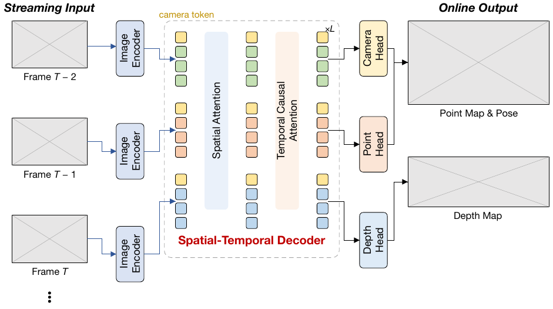</a></td>
</tr>
<tr>
<td><b><code>module-detail</code></b><br><i>"公式和接线对得上吗？"</i><br>单个模块展开，算子显式画出，张量维度标注在边上。单栏。</td>
<td><b><code>attention-tokens</code></b><br><i>"这个注意力模式凭什么更好？"</i><br>token 按来源着色，穿过淡色注意力区域。双栏。</td>
</tr>
<tr>
<td><a href="templates/streaming-worldmodel.yaml">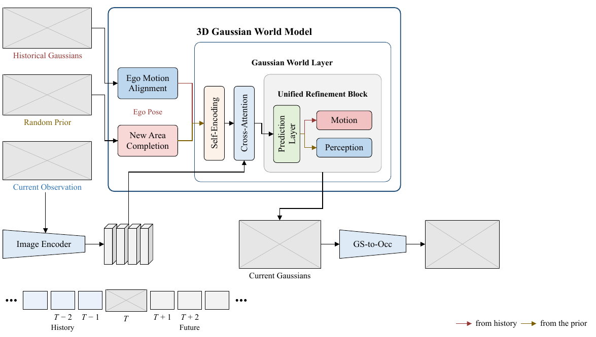</a></td>
<td><a href="templates/dual-branch.yaml">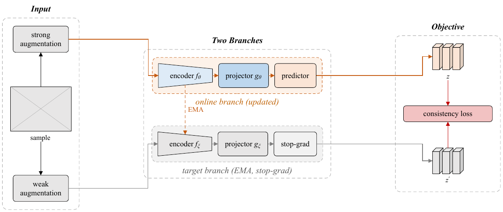</a></td>
</tr>
<tr>
<td><b><code>streaming-worldmodel</code></b><br><i>"帧与帧之间记住了什么？"</i><br>嵌套容器 + 时间轨；标签文字与所属数据流同色。双栏。</td>
<td><b><code>dual-branch</code></b><br><i>"两个分支是什么关系？"</i><br>师生 / 对比 / EMA。分支严格平行，stop-grad 用虚线。双栏。</td>
</tr>
<tr>
<td colspan="2"><a href="templates/gated-module.yaml">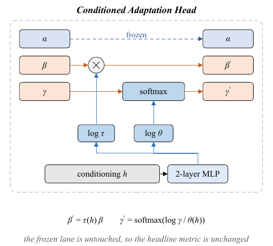</a>
<br><b><code>gated-module</code></b> —— <i>"你到底改了什么、冻了什么？"</i><br>
adapter、LoRA、FiLM、校准头。一条泳道冻结直通，其余被门控调制。两个算子**水平错开**，让每个门控从正下方垂直进入它驱动的那个算子，<b>零交叉</b>。单栏。</td>
</tr>
</table>

### 真实输入与真实预测——语料库里的默认形态

语料库里 57% 的框架图嵌了真实位图，其中三分之二在两端都放了图像。下面这五个模板就是
围绕这一点做的。

<table>
<tr>
<td colspan="2"><a href="templates/framework-with-io.yaml">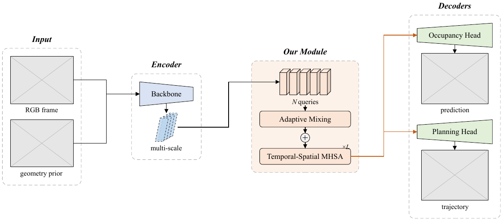</a>
<br><b><code>framework-with-io</code></b> — <i>"输入是什么，输出是什么？"</i><br>
语料库里最主流的形态：左边真实输入，中间架构，右边真实预测。把 <code>src:</code> 指向你自己的帧和渲染结果——<code>image</code> 会从文件读宽高比，所以只给宽度就够了。双栏。</td>
</tr>
<tr>
<td width="50%"><a href="templates/surroundview-pipeline.yaml">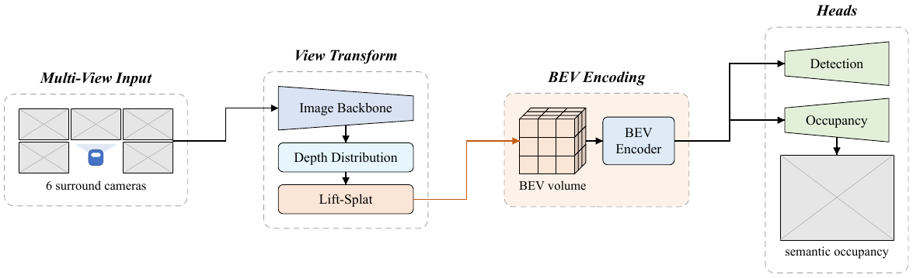</a></td>
<td width="50%"><a href="templates/teacher-student.yaml">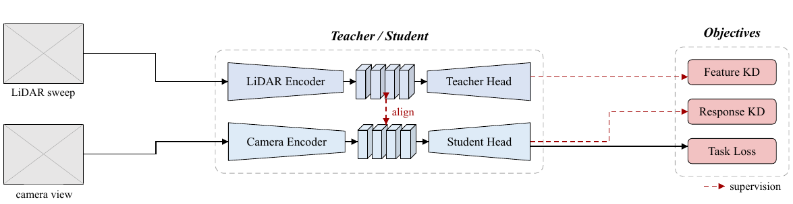</a></td>
</tr>
<tr>
<td><b><code>surroundview-pipeline</code></b><br><i>环视感知。</i><br><code>cameraring</code> 按 nuScenes / Waymo 论文的惯例排布六路视角——前三后三、中间自车图标——喂给 <code>voxelgrid</code> 的 BEV 体素。双栏。</td>
<td><b><code>teacher-student</code></b><br><i>"student 怎么从 teacher 学？"</i><br>两条同节奏的分支，蒸馏 loss 在对应深度上横向连接，而不是在末尾拉一根箭头。双栏。</td>
</tr>
<tr>
<td><a href="templates/trainable-frozen.yaml"></a></td>
<td><a href="templates/wrapped-pipeline.yaml">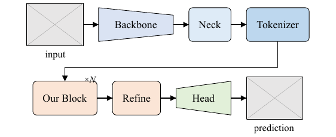</a></td>
</tr>
<tr>
<td><b><code>trainable-frozen</code></b><br><i>"哪些参数在训？"</i><br>火焰 / 雪花约定，但画成<b>矢量路径而不是贴进去的 emoji</b>，所以 600 dpi 下依然锐利，也能过 PDF/A。箭头颜色跟着标记走。双栏。</td>
<td><b><code>wrapped-pipeline</code></b><br><i>一行放不下的 pipeline。</i><br>折成两行。回折从上一行的<em>底部</em>出、进下一行的<em>顶部</em>，横向那一段就走在两行之间的空白里，而不是从方块中间穿过去。单栏。</td>
</tr>
</table>

### 分析 / 评测 / 立场类论文——没有网络可画

这几个存在的理由是：测量类论文同样有一条论证线，而图要承载的正是这条论证线。

<table>
<tr>
<td width="50%"><a href="templates/blindspot-teaser.yaml">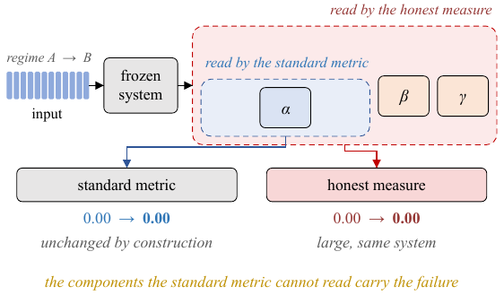</a></td>
<td width="50%"><a href="templates/factorial-2x2.yaml">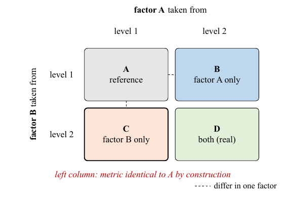</a></td>
</tr>
<tr>
<td><b><code>blindspot-teaser</code></b><br><i>"现有指标看不见什么？"</i><br>把子集关系画成<b>嵌套区域</b>，于是每个评估器只需要一根箭头，零交叉。第 1 页，单栏。</td>
<td><b><code>factorial-2x2</code></b><br><i>"受控设计隔离出了什么？"</i><br>两个因子交叉成四个条件，只有一格承载论断。单栏。</td>
</tr>
<tr>
<td><a href="templates/study-overview.yaml">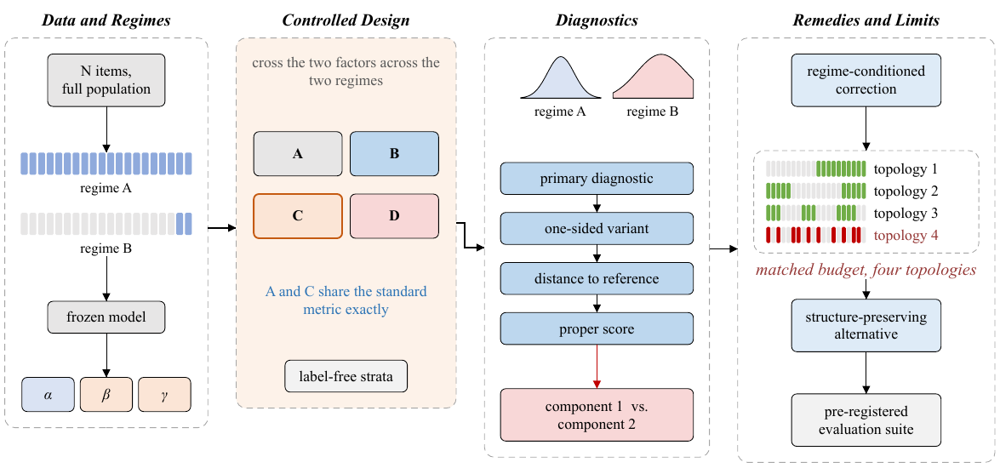</a></td>
<td><a href="templates/taxonomy.yaml">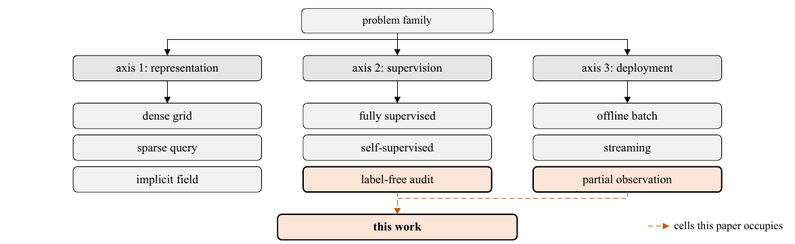</a></td>
</tr>
<tr>
<td><b><code>study-overview</code></b><br><i>"这项研究整体是什么形状？"</i><br>数据与工况 → 受控设计 → 诊断 → 补救<i>及其边界</i>。双栏。</td>
<td><b><code>taxonomy</code></b><br><i>"这项工作坐在领域的哪一格？"</i><br>领域划分，只有被占据的格子上色。引言 / 相关工作，双栏。</td>
</tr>
</table>

每个原型的完整规则和典型翻车方式，见 [`references/archetypes.md`](references/archetypes.md)。

---

## 输出格式

```bash
python3 scripts/render.py spec.yaml -o build/fig \
        -f svg,pdf,png,tiff,emf,vsdx,pptx --dpi 600
```

| 格式 | 由谁写出 | 可在哪里编辑 |
|---|---|---|
| `.svg` | 内置 | Illustrator、Inkscape、Figma、Affinity、浏览器 |
| `.vsdx` | **内置** | **Visio 原生编辑，不需要取消组合** |
| `.pptx` | **内置** | **PowerPoint 原生编辑；复制粘贴进 Visio 仍是形状** |
| `.pdf` | 自动挑已安装的转换器 | LaTeX `\includegraphics`、Illustrator |
| `.png` / `.tiff` | 按 `--dpi` 从 PDF 转出 | 幻灯片、rebuttal、海报 |
| `.emf` | Inkscape 或 LibreOffice | Word；Visio 导入后取消组合 |

### 关于清晰度

位图**一律从 PDF 转出**，绝不直接从 SVG。因为 LibreOffice 的 PNG 过滤器会静默忽略 DPI 设置，只给你一张 96 dpi 的截图——请求 600 dpi 实际只出 317 px。所以 `render.py` 改成用支持密度参数的工具去栅格化 PDF，并且**回读实际像素数和 `--dpi` 对账**，转换器偷懒就报警：

```
png via pdftoppm @600 dpi -- 4200 x 1857 px
```

投稿用 **600 dpi**，做海报用 **1200 dpi**。

---

## 编辑输出：Visio、PowerPoint、Illustrator

`build/fig.vsdx` 里每个模块都是**真正的 Visio 形状**，带自己的 geometry、fill、line、character 段：

- 点一下方框，格式面板里显示填充色 `#FFE699`；
- 拖顶点，几何直接更新——不需要取消组合；
- 双击改字，仍然是 7 pt Times New Roman；
- 箭头是 `EndArrow=4`（实心三角）的折线，控制点可拖。

> **关于位图面板**：`image` 节点在 `.vsdx` 里导出为带标签的占位矩形，渲染报告会列出跳过的文件。想让图片自动嵌进去就用 `.pptx`，或者在 Visio 里用*插入 → 图片*手动放。

### 模块面板（stencil）

完全不想写 YAML？生成一个可拖拽的调色板：

```bash
python3 scripts/make_stencil.py -o build/stencil -f vsdx,pptx
```

<p align="center">
  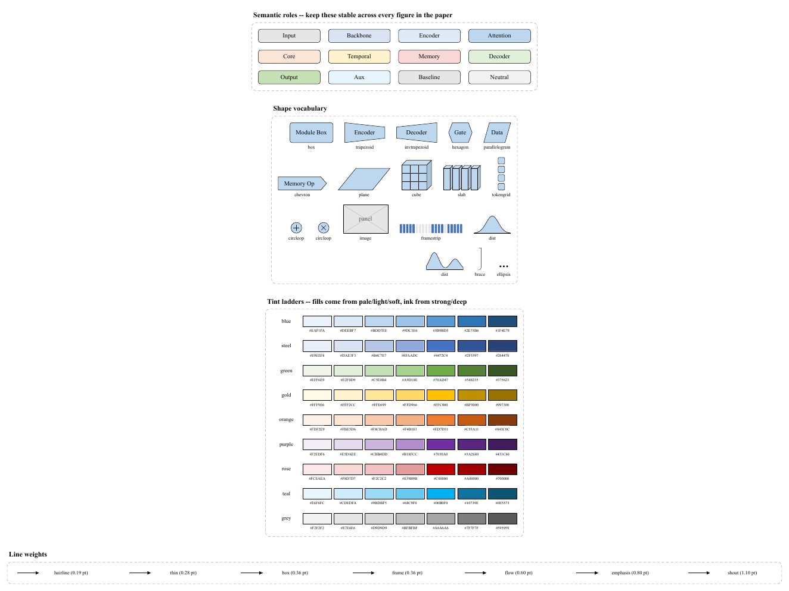
</p>

开在第二个窗口里，直接复制过来。复制过去的模块自带房屋样式的填充、描边、圆角和 7 pt Times 标签。

完整往返说明见 [`references/visio-workflow.md`](references/visio-workflow.md)。

---

## 审计器

```bash
python3 scripts/validate.py spec.yaml --svg build/fig.svg [--strict] [--json]
```

大约四十项检查，完整列表见
[`references/anti-ai-checklist.md`](references/anti-ai-checklist.md)。最重要的几项：

| 代码 | 级别 | 抓什么 |
|---|---|---|
| `text-too-small` | error | **最终印刷尺寸**下小于 6.0 pt 的文字（6.5 pt 以下警告；模块名不低于 7.0 pt）|
| `undefined-symbol` | error | 既没在图中文字里写明、也没在图注里定义的符号 |
| `symbol-not-in-caption` | error | 标为 `defined_in: caption`，图注里却没写 |
| `legend-unused-entry` | error | 图例里有、图里却没有用到的项 |
| `short-final-segment` | error | 拐弯箭头最后一段太短——WPS 会把箭头画成 45° |
| `corridor-too-narrow` | error | 空隙放不下要从中穿过的线 |
| `ai-palette` | error | Tailwind / Material / Bootstrap 默认色 |
| `image-low-ppi` | error | 嵌入图片在印刷尺寸下不足 300 ppi（600 以下警告）|
| `label-overflow` / `node-overlap` | error | 文字比框宽、模块重叠 |
| `text-off-canvas` / `edge-off-canvas` | error | 会被 LaTeX 裁掉的内容 |
| `inconsistent-role` | error | 同一个概念画成了两种颜色 |
| `upright-variable` | warning | 图里 `z_t` 是正体，正文里却是斜体 |
| `unexplained-line-style` | warning | 虚线或彩色箭头既不在图例里、也没有标注 |
| `edges-share-corridor` | warning | 两条线挤在一起，看起来像一条 |
| `edge-crosses-node` / `edge-crosses-text` | warning | 箭头穿过模块、图题或标签 |
| `saturated-fill` / `tinted-outlines` | warning | UI 卡片式的"AI 感" |

有 error 时退出码非零，加 `--strict` 时 warning 也会非零——可以直接挂进 CI 或 pre-commit。

### 交付之后

真正交付的不是 spec。PPTX 一旦被手动修改，它就是唯一的源文件；要审计它，以及从它导出的 PDF：

```bash
python3 scripts/audit_pptx.py fig.pptx --width 496.8 --spec spec.yaml   # 任意 PPTX，FigGenie 的也行
python3 scripts/audit_pptx.py fig.pptx --width 496.8 --fix fig_fixed.pptx   # 关掉主题阴影、调回过低的下标
python3 scripts/export_pptx.py fig.pptx --width 496.8                   # 无损导出 PDF 并审计
python3 scripts/audit_pdf.py   fig.pdf  --width 496.8
```

在一篇真实投稿手动修改过的总览图上，`audit_pptx.py` 准确报出了最终流进 PDF 的三类问题：
两条被 WPS 画成 45° 的拐弯箭头（最后一段只有 2.5 pt 和 3.5 pt）、20 处被抹平成普通文字
的下标（`z1:4`、`O5:10`、`d1`……）、以及一个指向已删除箭头的图例项。详见
[`references/after-handover.md`](references/after-handover.md)。

审计器判断不了图**是否讲清楚了**。请渲染一张 PNG 亲眼看一遍。

---

## 放进论文里

引擎以**最终印刷磅值**排版，`venue` + `width` 会把画布设成该会场的精确栏宽。所以：

```latex
\begin{figure*}[t]
  \centering
  \includegraphics[width=\linewidth]{figures/overview.pdf}
  \caption{\textbf{Overview of X.} <论断>。<从左到右的各个部件>。}
  \label{fig:overview}
\end{figure*}
```

就是 100% 呈现，spec 里的 `size: 7.5` 在纸上就是 7.5 pt。

想放到栏宽的 80%？在 **spec 里**设 `width_frac: 0.8`，LaTeX 那边保持 `width=\linewidth`。
写成 `width=0.8\linewidth` 会把字号一起缩到 6.0 pt。

图注要写明论断、按阅读顺序列出部件、说明颜色含义，并**定义图里每一个没有用文字写明的
符号**——写完一定重新编译检查页数，因为图注多一行，后面的正文就会往后挪一行。PDF 必须是
无损的：`render.py` 和 `export_pptx.py` 会处理好，`audit_pdf.py` 负责确认。

| 会场 | `\columnwidth` | `\textwidth` |
|---|---|---|
| CVPR / ICCV / WACV | 237.13 pt | 496.85 pt |
| ECCV (LNCS) | 347.12 pt | 347.12 pt |
| NeurIPS / ICLR | 397.48 pt | 397.48 pt |
| ICML | 234.88 pt | 487.82 pt |
| AAAI | 238.49 pt | 504.00 pt |
| ACL / EMNLP | 219.08 pt | 455.24 pt |

浮动体摆放和 camera-ready 检查清单见
[`references/latex-integration.md`](references/latex-integration.md)。

### 让图可复现

```
figures/
  overview.pdf          <- LaTeX 引用的
  overview.pptx         <- 发给合作者改的
  src/overview.yaml     <- spec，进版本库
  src/crops/*.png       <- 真实数据截图
```

```bash
for f in figures/src/*.yaml; do
  python3 scripts/render.py "$f" -o "figures/$(basename "${f%.yaml}")" \
          -f svg,pdf,pptx --dpi 600
done
```

---

## 仓库结构

```
SKILL.md                  Claude Code 入口（带 frontmatter 路由）
AGENTS.md                 Codex / 其他 agent 入口
manifest.yaml             什么任务加载哪个片段
install.sh                一条命令装成 Claude Code skill

static/core/
  stance.md               不可妥协的规矩 + "AI 味"清单
  contract.md             动笔前必须回答的八个问题

references/
  corpus-report.md        每一项测量，以及被砍掉的规则
  house-style.md          量出来的配色/字号/线宽，以及测量方法本身
  spec-language.md        spec 完整语法
  archetypes.md           各个原型，以及各自的成败关键
  from-code.md            从源码出图：它推断什么、在哪里会错
  case-studies.md         已发表论文的图逐张拆解
  anti-ai-checklist.md    自动审计项 + 人眼复核流程
  visio-workflow.md       Visio / PowerPoint / Illustrator 编辑
  latex-integration.md    尺寸换算、浮动体、图注、无损导出、camera-ready 检查
  symbols-and-captions.md 标签里的数学写法、符号表、图注
  after-handover.md       审计手动改过的 PPTX 和导出的 PDF
  app-compatibility.md    WPS / Keynote / LibreOffice / PowerPoint 实测差异

scripts/
  render.py               spec -> svg / pdf / png / tiff / emf / vsdx / pptx
  from_code.py            PyTorch 源码或 mmdet config -> spec
  validate.py             审计器（spec）
  audit_pptx.py           审计任意 PPTX（手动修改之后）
  audit_pdf.py            审计 LaTeX 引用的 PDF
  export_pptx.py          无损 PPTX -> PDF（LibreOffice 或 Keynote）
  make_stencil.py         模块面板生成器
  cvprfig/                引擎（纯标准库）
    palettes.py           三套实测色板，各自保持完整
    style.py              字号、线宽、几何常量、语义角色
    text.py               烘焙好的 Adobe Core-14 字宽、行内标记、数学排版、符号抽取
    ooxml.py              读回任意 PPTX：路径、文字、图片、连接关系
    imgsize.py            PNG/JPEG/GIF/PDF 尺寸读取，零依赖
    imgcolor.py           在图片里找图例颜色，计入明暗着色（需 Pillow 或 PyMuPDF）
    layout.py             盒模型求解器
    edges.py              正交路由
    shapes.py             形状词汇表
    svg.py vsdx.py pptx.py   同一套版面的三个渲染后端
    miniyaml.py           零依赖 YAML 子集解析器
    code2fig/             图 IR、两个源码 reader、spec 生成器
      graph.py            IR、角色推断、剪枝、分支着色
      torchscan.py        nn.Module 源码 -> 图（走 ast）
      mmconfig.py         mmengine/mmdet config -> 图（走 ast）
      emit.py             图 -> spec，含栏宽自适应阶梯

templates/                十六个原型 + stencil.vsdx / stencil.pptx
examples/quickstart.yaml  上面那个 50 行示例
assets/gallery/           渲染预览
tests/test_engine.py      回归测试（引擎、导出器、审计器、code2fig）
```

---

## 测试

```bash
python3 tests/test_engine.py
```

212 项检查，零依赖，几秒钟。覆盖：字宽测量对照已发表论文的实际框宽、内置 YAML 解析器（与 PyYAML 输出逐字节一致）、版面吸附、端口法向路由、颜色与具名线宽解析、容器嵌套形式、每一种形状、**十六个**模板的渲染**并且通过审计**、`.vsdx` / `.pptx` 包结构与形状数量、位图嵌入与真实宽高比、两个代码 reader 的端到端行为（子模块、数据流边、分支保留、管道模块剪枝、角色推断、config 注释）、栏宽自适应阶梯，以及审计器自身的正反例。

CI 在 Python 3.9 / 3.11 / 3.13 上**不装任何依赖**跑这些测试，所以一旦有人引入依赖，构建会直接失败。

---

## 常见问题

<details>
<summary><b>能画柱状图、曲线、热力图、消融实验图吗？</b></summary>

不能，而且它会明确告诉你。那些是 matplotlib/seaborn 的活。本项目专攻 matplotlib 不擅长的部分：架构图、pipeline、teaser、模块细节图、分类树。
</details>

<details>
<summary><b>用了图像生成模型吗？</b></summary>

没有。既不用扩散模型，也不让 LLM 直接写 SVG 坐标——这两条恰恰会产出本项目要消灭的那种通用感。所有坐标由确定性求解器算出，所以同一份 spec 永远得到同一张图，spec 的 diff 就是图的 diff。
</details>

<details>
<summary><b>它会编造我的实验结果吗？</b></summary>

不会。没有 `src` 的 `image` 节点会渲染成**故意很显眼**的带标签占位框，让未完成的图不可能被误当成完成品；渲染报告还会列出哪些槽位还空着。
</details>

<details>
<summary><b>图太宽了怎么办？</b></summary>

渲染器会整体缩放，并告诉你**实际生效**的字号：

```
WARNING: Layout is 539.6 pt wide but the target column is 504.0 pt,
         so the figure is scaled to 93%; body labels render at ~6.5 pt.
```

低于 6.0 pt 就升级成 error。正确的解法是缩短标签、砍掉一个阶段、或者拆成两张图——不是接受这个缩放。
</details>

<details>
<summary><b>改完 <code>.vsdx</code> 能反解回 spec 吗？</b></summary>

不能，没有反向解析器。建议在结构还在变的阶段以 spec 为准，等版面定稿之后再转去直接改 `.vsdx` / `.pptx`。
</details>

<details>
<summary><b>转换之后字体不对。</b></summary>

SVG 里写的是 `Times New Roman, Nimbus Roman, Liberation Serif, Times, serif`，会优雅降级，但转换器有自己的替换策略。用 `pdffonts build/fig.pdf` 检查；要求字形精确就用 Inkscape 加 `--export-text-to-path` 转。
</details>

<details>
<summary><b>怎么模仿某一篇论文的风格？</b></summary>

直接从它发表的 PDF 里把配色量出来——方法就在 [`references/house-style.md`](references/house-style.md) 开头；然后照着那些颜色写 spec。[`references/case-studies.md`](references/case-studies.md) 把五张知名论文图逐个手法拆开讲了。
</details>

<details>
<summary><b>两个东西同名但必须不同颜色。</b></summary>

通常正确的解法是把名字区分开——真实的 dual-branch 图会写 `encoder f_θ` 和 `encoder f_ξ`，而不是两个 `encoder`。如果这个对比确实就是重点，在节点上设 `same_label_ok: true` 单独关掉这一项检查。
</details>

---

## 参考语料与致谢

样式常量是从以下已发表论文 PDF 的矢量内容中测量得到的。只提取了排版参数——配色、字号、线宽、几何——**未复制任何图形内容**；`assets/gallery/` 里的全部示例均由本项目自己的模板渲染生成。

| 论文 | 会场 |
|---|---|
| SparseWorld: A Flexible, Adaptive and Efficient 4D Occupancy World Model | arXiv:2510.17482 |
| GaussianWorld: Gaussian World Model for Streaming 3D Occupancy Prediction | CVPR 2025, arXiv:2412.10373 |
| EmbodiedOcc: Embodied 3D Occupancy Prediction | arXiv:2412.04380 |
| StreamVGGT: Streaming Visual Geometry Transformer | arXiv:2507.11539 |
| TPVFormer: Tri-Perspective View for 3D Semantic Occupancy Prediction | CVPR 2023, arXiv:2302.07817 |

测量方法与完整数值见 [`references/house-style.md`](references/house-style.md)——你可以对任何一篇你欣赏其配图的论文重复这个过程。

---

## 参与贡献

欢迎 issue 和 PR。请确保 `python3 tests/test_engine.py` 通过，并且新增模板的审计器 **error 为零**——CI 两项都会检查。

特别欢迎：

- 本项目尚未覆盖领域的**新原型**（NLP、语音、强化学习、理论、机器人系统）；
- 用真实 `\the\columnwidth` 核实过的**会场栏宽**；
- 从其他实验室论文图中量出的**样式数据**。

## 许可

[MIT](LICENSE) © 2026 Zhao Liu。

可自由用于论文、商业用途和二次分发。除保留许可声明外无需署名——不过如果这些图帮到了你，欢迎给个 star 或提一句。
